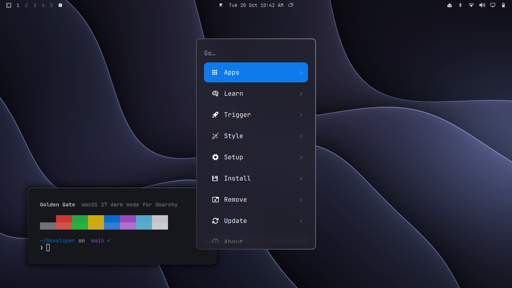

# Golden Gate theme

**Status:** ✅ working, verified 2026-10-20 on Omarchy 4.0.6
**Applies to:** any Omarchy machine

macOS 27 "Golden Gate" dark mode for Omarchy. It's the same theme as
[pavandot/omarchy-golden-gate-theme](https://github.com/pavandot/omarchy-golden-gate-theme),
installed here as a local theme so its Hyprland settings apply without the separate
glass opt-in.



## What it changes

- **Palette:** Apple dark-mode system colours, system blue accent `#0a84ff`, window greys with a faint indigo cast (`#1c1b24`)
- **Bar:** no background, so the bar's text sits straight on the wallpaper
- **Glass:** frosted, indigo-tinted menus, launcher, notifications and popovers. The password prompt is frosted more heavily (0.9)
- **Bar dropdowns:** a light graphite pill for chosen options and slider tracks, as in macOS Control Center
- **Windows** (`hyprland.lua`): 1px specular borders, a darker edge shadow, 12px squircle corners, 8px gaps between windows and at the screen edges
- **T3 Code** (`t3code.json`): all ~60 colours set, so nothing comes out navy from the accent
- **Chromium-family browsers** (`chromium.theme`): near-grey seed `#1d1d22`, so the toolbar stays graphite instead of turning violet
- **Wallpaper:** an original wallpaper in the Golden Gate style. Apple's own Golden Gate Dark and Bridge wallpapers are optional (`--apple-wallpapers`)

## Check
```
omarchy theme current          # "Golden Gate" when applied
./install.sh status            # whether the installed copy matches this repo
```

## Install
```
cd customizations/golden-gate-theme
./install.sh install --apple-wallpapers
```
This copies `golden-gate/` to `~/.config/omarchy/themes/golden-gate/` and applies it. It
records your current theme for `revert`. `--apple-wallpapers` downloads Apple's
wallpapers into `~/.config/omarchy/backgrounds/golden-gate/` and switches to Golden
Gate Dark. Leave the flag off to keep the original wallpaper only.

### Optional: bigger terminal text
The theme doesn't set font size. foot defaults to size 9, which is small at 1.5×
scaling. This raises it to 11, macOS Terminal's default:
```
cp ~/.config/foot/foot.ini ~/.config/foot/foot.ini.bak
sed -i 's/^font=\(.*\):size=[0-9]*$/font=\1:size=11/' ~/.config/foot/foot.ini
```
New terminal windows pick it up.

## Verify
- `hyprctl configerrors` prints nothing.
- The bar has no background, and Super+Space opens a frosted menu with a solid blue selected row.
- Two tiled windows have even 8px gaps, and the active one has a faint white top-left edge.
- T3 Code's sidebar is graphite, and Chromium's toolbar is grey, not violet.

## Revert
```
./install.sh revert
```
This switches back to the theme you had before install, and moves the theme folder to
`~/.local/state/omarchy-vivobook-setup/`. Downloaded Apple wallpapers stay in
`~/.config/omarchy/backgrounds/golden-gate/`; delete that folder to remove them.

## Notes
- **Re-applying moves to the next wallpaper.** That's how Omarchy works: running
  `omarchy theme set golden-gate` while it's already active steps through the backgrounds.
- **Apple's wallpapers aren't stored in this repo.** They're Apple's artwork; the
  script downloads them from the [512 Pixels](https://512pixels.net/2026/07/golden-gate-bridge-wallpaper/) archive.
- **Rebuild the original wallpaper:** `python3 -I golden-gate/extras/make-wallpaper.py out.jpg` (needs numpy and pillow).
